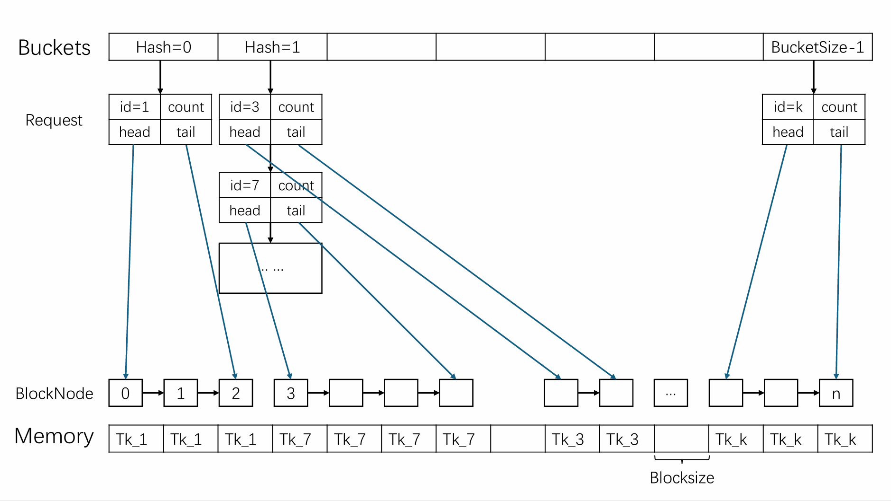

# 实验报告

实验所有代码 数据 等文件详细可见[github repo](https://github.com/XY-Asuna/MiniKV)（ https://github.com/XY-Asuna/MiniKV ）
## 数据结构设计

图1 数据结构设计图

**说明**
1. 使用数组模拟内存`Memory` 每个元素代表一个`Block` 存储 `onwer`和`used`信息
2. 每个`Request`的`head`与`tail`维护一个`BlockNode`链表 其`index`与`Memory`数组一一对应
3. 使用数组`Buckets`作为哈希数组
4. 每个哈希值对应一个`Request`链表 存储哈希冲突的各个`Request`信息
5. `Request`链表节点存储`Request`的信息 其中`head` 和 `tail` 分别指向该token在内存中的首尾位置
## 算法设计
### 构造函数
1. 申请并初始化`Memory`数组空间
2. 申请并初始化`Buckets`数组空间 每个元素初始化一个`Request`链表
3. 若为`Paged Strategy` 则另外申请`to_used_index`供后续`allocate()`和`append()`使用
#### 伪代码实现
```cpp
ContiguousKV / PagedKV 构造函数
{
    n_ = blockCount, s_ = blockSize
    Memory = new Block[blockCount]
    for i = 0 to blockCount-1
        Memory[i].owner = "" , Memory[i].used = 0      // 初始化为空闲块
    Buckets = new Request*[bucketsSize]
    for i = 0 to bucketsSize-1
        Buckets[i] = 新建 Request 作为空头节点          // hashNext = nullptr, id = "", tokenCount = -1
    if Paged Strategy
        to_use_index = new int[blockCount]              // 供 allocate() 与 append() 记录空闲块下标
}
```
### 析构函数
1. 释放`Memory`数组空间
2. 释放每个`Request`对应的`BlockNode`链表空间 然后释放该`Request`链表空间
3. 释放`Buckets`数组空间
4. 若为`Paged Strategy` 则释放`to_used_index`空间
#### 伪代码实现
```cpp
析构函数
{
    释放 Memory 数组空间
    for i = 0 to bucketsSize-1
    {
        p = Buckets[i]
        while p != nullptr                               // 逐个释放哈希链上的 Request 节点
        {
            沿 p->head 链 依次释放该 Request 的全部 BlockNode 节点
            temp = p->hashNext
            释放 p
            p = temp
        }
    }
    释放 Buckets 数组空间
    if Paged Strategy
        释放 to_use_index 空间
}
```
### allocate
#### 算法逻辑
1. 判断`tokenCount`合法性以及调用`lookup`函数判断该`token`是否已经存在
2. 
   1. **Contiguous Strategy**：遍历`Memory`数组 寻找连续的空闲块并记录即将存放的内存块的首尾位置
   2. **Paged Strategy**：遍历`Memory`数组 寻找空闲块并用`to_used_index`记录即将存放的位置
3. 计算哈希值 将`Request`插入到对应的哈希链表中
4. 更新`Memory`数组中对应的`Block`的`owner`和`used`信息 同时使用尾插法创建`BlockNode`链表
#### 伪代码实现
```cpp
bool allocate(id, tokenCount)
{
    if tokenCount <= 0 return 0                    // 合法性检查
    if lookup(id) != nullptr return 0              // ID 已存在

    // 搜索空闲空间
    if Contiguous Strategy                         // 首次适应 寻找足够长的连续空闲段
    {
        start = 0, block_count = 0
        while start < n
        {
            if Memory[start] 空闲 then block_count++ else block_count = 0
            if s * block_count >= tokenCount       // 已找到足够长的连续段
            {
                start -= block_count - 1           // 回退至段首
                break
            }
            start++
        }
        if start >= n return 0                     // 不存在满足要求的连续段
    }
    else  // Paged Strategy                        // 收集空闲块 容量足够即提前停止
    {
        available_count = 0
        for i = 0 to n-1
        {
            if Memory[i] 空闲 then to_use_index[available_count++] = i
            if s * available_count >= tokenCount break
        }
        if s * available_count < tokenCount return 0
    }

    // 计算哈希值 将新 Request 尾插入对应哈希链
    p = Buckets[fnv1a(id)]
    while p->hashNext != nullptr p = p->hashNext
    new_temp = 新建 Request{id, tokenCount, head = nullptr}
    p->hashNext = new_temp

    // 更新内存信息 并使用尾插法创建 BlockNode 链表
    ptr = nullptr
    for 每个选中块下标 idx  // Contiguous: start 起连续 block_count 块 / Paged: to_use_index[0..available_count)
    {
        Memory[idx].owner = id
        Memory[idx].used = min(剩余tokenCount, s)
        if 剩余tokenCount >= s then 剩余tokenCount -= s else 剩余tokenCount = 0
        尾插 BlockNode{index = idx} 至 new_temp 链表
    }
    new_temp->tail = ptr
    return 1
}
```
#### 复杂度分析
1. 调用`lookup`函数的时间复杂度为 $O(1)$
2. 遍历`Memory`数组的时间复杂度为 $O(n)$
3. 计算哈希值的时间复杂度为 $O(1)$
4. 更新`Memory`数组和创建`BlockNode`链表的时间复杂度为 $O(n)$

可以看出`allocate`函数的时间复杂度为 $O(n)$
### append
#### 算法逻辑
1. 判断`tokenCount`合法性以及调用`lookup`函数判断该`token`是否已经存在
2. 判断原有`token`所占最后一块`Block`剩余空间是否足够 若足够则直接在原有`Block`上追加 否则进入后续步骤
3. 
   1. **Contiguous Strategy**：遍历`Memory`数组 寻找连续的空闲块并记录即将存放的内存块的首尾位置
   2. **Paged Strategy**：遍历`Memory`数组 寻找空闲块并用`to_used_index`记录即将存放的位置
4. 将原有`token`所占最后一块`Block`填满
5. 计算哈希值 寻找到对应的`Request`
6. 更新`Memory`数组中对应的`Block`的`owner`和`used`信息 同时在尾部插入对应节点以更新`BlockNode`链表
#### 伪代码实现
```cpp
bool append(id, newTokenCount)
{
    if newTokenCount <= 0 return 0                 // 合法性检查
    target_ = lookup(id)
    if target_ == nullptr return 0                 // ID 不存在

    start = target_->tail->index
    last_left = s - Memory[start].used             // 尾块剩余容量
    if newTokenCount <= last_left                  // 快速路径 尾块剩余空间足够
    {
        Memory[start].used += newTokenCount
        target_->tokenCount += newTokenCount
        return 1
    }

    // 搜索剩余空间
    if Contiguous Strategy                         // 从尾块之后扫描 遇占用块立即失败
    {
        block_count = 0
        for i = start+1 to n-1
        {
            if Memory[i] 空闲 then block_count++ else return 0   // 连续性被破坏
            if last_left + s * block_count >= newTokenCount break
        }
        if last_left + s * block_count < newTokenCount return 0
    }
    else  // Paged Strategy
    {
        available_count = 0
        for i = 0 to n-1
        {
            if Memory[i] 空闲 then to_use_index[available_count++] = i
            if last_left + s * available_count >= newTokenCount break
        }
        if last_left + s * available_count < newTokenCount return 0
    }

    // 补齐 尾插新节点
    Memory[start].used += last_left                // 填满尾块
    target_->tokenCount += newTokenCount
    剩余newTokenCount = newTokenCount - last_left
    ptr = target_->tail
    for 每个选中块下标 idx
    {
        Memory[idx].owner = id
        Memory[idx].used = min(剩余newTokenCount, s)
        if 剩余newTokenCount >= s then 剩余newTokenCount -= s else 剩余newTokenCount = 0
        尾插 BlockNode{index = idx} 至链表尾部
    }
    target_->tail = ptr
    return 1
}
```
#### 复杂度分析
1. 调用`lookup`函数的时间复杂度为 $O(1)$
2. 判断原有`token`所占最后一块`Block`剩余空间的时间复杂度为 $O(1)$
3. 遍历`Memory`数组的时间复杂度为 $O(n)$
4. 填满原有`token`所占最后一块`Block`的时间复杂度为 $O(1)$
5. 计算哈希值的时间复杂度为 $O(1)$
6. 更新`Memory`数组和`BlockNode`链表的时间复杂度为 $O(n)$

可以看出`append`函数的时间复杂度为 $O(n)$
### lookup
#### 算法逻辑
##### 哈希函数：fnv1a
作为一种实现相对简单 结果稳定且性能较好的哈希函数。对比fnv1通过改变异或和乘法的顺序来提高雪崩效应 保证了哈希值的均匀随机性。
##### 算法逻辑
1. 通过哈希函数计算`token`的哈希值`bucket_id`
2. 按顺序遍历`Buckets[bucket_id]`对应的`Request`链表 比较`id` 若匹配则返回 否则返回`nullptr`
#### 伪代码实现
```cpp
// 哈希函数: 64 位 FNV-1a
int fnv1a(id)
{
    H = 14695981039346656037                       // FNV-1a 64 位偏移基数
    for 每个字符 c in id
        H ^= (unsigned char)c, H *= 1099511628211  // FNV 质数 无符号溢出等价于 mod 2^64
    return H mod bucketsSize
}
```
```cpp
const Request* lookup(id)
{
    buckets_id = fnv1a(id)
    p = Buckets[buckets_id]->hashNext              // 跳过空头节点
    while p != nullptr
    {
        if p->id == id return p                    // 匹配成功
        p = p->hashNext
    }
    return nullptr                                 // 遍历结束仍未找到
}
```
#### 复杂度分析
1. 哈希函数的时间复杂度为 $O(k)$ 其中$k$为`id`长度
2. 遍历`Buckets[bucket_id]`对应的`Request`链表的时间复杂度为 $O(m)$ 其中$m$为该链表长度
3. 最坏情况下`lookup`函数的时间复杂度为 $O(k+m)$

随机数据下 可以认为整个`lookup`作为哈希索引的时间复杂度为 $O(1)$
### free
#### 算法逻辑
1. 调用`lookup`函数查找对应的`Request` 若不存在则返回错误
2. 根据该`Request`对应的`BlockNode`链表 依次释放对应的`Block` 并更新`Memory`数组中对应的`Block`的`owner`和`used`信息
   1. 若为`Contiguous Strategy` 由于连续性 可以循环从头到尾遍历内存块的编号进行删除 以简化代码实现
3. 删除该`Request`对应的`BlockNode` 具体地：
   1. 调用`fnv1a`计算哈希值
   2. 从`Buckets`数组中找到对应的`Request`的前驱节点
   3. 暂存该`Request`节点
   4. 将前驱节点的`next`指针指向该`Request`节点的`next`
   5. 释放该`Request`节点
#### 伪代码实现
```cpp
bool free(id)
{
    target_ = lookup(id)
    if target_ == nullptr return 0                 // ID 不存在
    
    // 清空并释放对应的内存块 沿 BlockNode 链表释放节点
    if Contiguous Strategy                         // 连续存放 可直接按 [head->index, tail->index] 遍历
    {
        start = target_->head->index, end = target_->tail->index
        ptr = target_->head
        for i = start to end
        {
            Memory[i].owner = ""
            Memory[i].used = 0
            释放 ptr 并沿链前移至下一节点
        }
    }
    else  // Paged Strategy                        // 离散存放 只能沿链表逐块释放
    {
        ptr = target_->head
        while ptr != nullptr
        {
            Memory[ptr->index].owner = ""
            Memory[ptr->index].used = 0
            释放 ptr 并前移至下一节点
        }
    }

    // 从哈希链中摘除并释放该 Request
    p = Buckets[fnv1a(id)]
    while p->hashNext->id != id p = p->hashNext    // 寻找前驱节点
    delete_temp = p->hashNext
    p->hashNext = delete_temp->hashNext
    释放 delete_temp
    return 1
}
```
#### 复杂度分析
1. 调用`lookup`函数的时间复杂度为 $O(1)$
2. 遍历并删除`BlockNode`链表的时间复杂度为 $O(n)$
3. 删除`Request`节点的时间复杂度为 $O(1)$ （可以认为寻找前驱节点的过程也是哈希索引）
### displayMemory
#### 算法逻辑
1. 遍历`Memory`数组 输出每个`Block`的`owner`和`used`信息
#### 伪代码实现
```cpp
void displayMemory()
{
    for i = 0 to n-1
    {
        if Memory[i].owner == "" 输出 "-"          // 空闲块
        else 输出 Memory[i].owner                  // 被占用的块输出其 owner
        if i != n-1 输出 " "                       // 块之间以空格分隔
    }
}
```
#### 复杂度分析
1. 遍历`Memory`数组的时间复杂度为 $O(n)$
### displayRequest
#### 算法逻辑
1. 调用`lookup`函数查找对应的`Request` 若不存在则返回`Not Found`
2. 遍历该`Request`对应的`BlockNode`链表 输出每个节点的`index`信息
   1. 若为`Contiguous Strategy` 由于连续性 可以循环从头到尾遍历内存块的编号进行输出 以简化代码实现
#### 伪代码实现
```cpp
void displayRequest(id)
{
    target_ = lookup(id)
    if target_ == nullptr
    {
        输出 "NOT FOUND"
        return
    }
    输出 target_->tokenCount
    if Contiguous Strategy                         // 连续存放 块数 = 首尾下标之差 + 1 按编号直接输出
    {
        start = target_->head->index, end = target_->tail->index
        输出 end - start + 1
        for i = start to end 输出 i (以空格分隔)
    }
    else  // Paged Strategy                        // 离散存放 块数 = ceil(tokenCount / s) 沿链表逐节点输出
    {
        输出 (target_->tokenCount - 1) / s + 1
        ptr = target_->head
        while ptr != nullptr
        {
            输出 ptr->index (以空格分隔)
            ptr = ptr->next
        }
    }
}
```
#### 复杂度分析
1. 调用`lookup`函数的时间复杂度为 $O(1)$
2. 遍历`BlockNode`链表的时间复杂度为 $O(n)$
## 算法分析与实验评估
### 算法分析
#### 时间复杂度分析
各个函数时间复杂度汇总如下：
|函数|最坏时间复杂度|平均时间复杂度|说明|
|---|---|---|---|
|constructor|O(n)|O(n)|主要耗时为 遍历Memory初始化以及遍历Buckets初始化Request链表|
|destructor|O(n)|O(n)|主要耗时为 遍历Memory释放以及遍历Buckets释放Request链表 注意$\sum$ BlockNode$ \leq$ n|
|allocate|O(n)|O(n)|主要耗时为 遍历Memory寻找空闲块以及遍历Memory更新相应信息|
|append|O(n)|O(n)|主要耗时为 遍历Memory寻找空闲块 遍历Memory更新相应信息 维护BlockNode链表|
|lookup|O(k+m)|O(1)|主要耗时为计算哈希值以及遍历Buckets对应的Request链表|
|free|O(n)|O(n)|主要耗时为 遍历BlockNode链表释放内存块以及维护Buckets对应的Request链表|
|displayMemory|O(n)|O(n)|主要耗时为遍历Memory数组输出信息|
|displayRequest|O(n)|O(n)|主要耗时为遍历BlockNode链表输出信息|

注：我们认为 n $>>$ k,m 即当复杂度为 O(n) 时 可忽略k+m的影响

因此 我们可以认为整个系统的时间复杂度为 O(n)

#### 空间复杂度分析
|结构|空间复杂度|说明|
|---|---|---|
|Memory数组|O(n)|每个Block存储owner与used信息|
|Buckets数组|O(BucketsSize)|每桶一个空头Request节点|
|Request节点|O(id数)||
|BlockNode链表|O(n)|各请求块数之和即$\sum\lceil$ tokenCount$/$BlockSize$\rceil$不超过n|
|to_use_index|O(n)|（仅Paged）`allocate`与`append`统计空闲块下标的辅助数组|

两种策略的总空间复杂度均为O(n+BucketsSize)。Paged Strategy增加一个O(n)的辅助数组

### 实验说明
#### 数据说明
为了更好地评估两个策略的性能表现 我们对 `gen.cpp` 生成数据进行了部分调整 下面分点叙述调整内容并说明其正当性。
1. 固定随机种子 `seed` 。在提交`matrix`测评并通过之后 我们将`seed`固定为`12345` 以保证实验结果的可复现性。
2. 按特定比例放大各个数据规模。在现代cpu上运行 原有数据规模过小 对总耗时的计时的具体数值过小 受到计时器精度以及随机波动的影响较大。为实现较为精确的计时以获得更准确地对性能评估 我们放大了各个数据规模的数量级。
3. 固定 $N \times BlockSize = C$ 其中 $C$ 为常数。我们固定不同测例下总内存大小为常数 通过调整`BlockSize`大小来模拟不同的内存分配策略 并测量其对性能的影响。
4. 调整了`ALLOC`和`APPEND`函数生成`token`的逻辑 并同时调整了`FREE`的相关逻辑。分析原有生成的数据 我们发现：受`tokenBudget`的限制 在数据末尾（占比超过30%）的`ALLOC`和`APPEND`函数生成的`token`的长度恒为1 这显然不符合实际情况。为更好地模拟实际情况 我们去除了`tokenBudget`的限制 并保证期望下的 `ALLOC`和`APPEND` 可以提前实现占满内存（剩余过量分配可以评估内存不足的情况）。
5. 调整了`ALLOC`和`APPEND`函数出现的限制。分析原有数据发现 分配内存失败的原因均为ALLOC id已存在 或 APPEND id不存在 这无法体现内存分配策略对有限的内存空间利用的差异性。对此 我们对`ALLOC`和`APPEND`函数的生成逻辑进行了调整 减少出现上述非内存相关情况 以更好地体现内存分配策略的差异性。
6. 其余改动均为实现生成多组命名规范数据的功能。
#### 实验环境说明
1. Windows 11 家庭版 中文版
2. Intel(R) Core(TM) Ultra 9 275HX 2.70 GHz
3. gcc (Rev8, Built by MSYS2 project) 15.2.0 开启 -O2 优化
#### main.cpp 说明
1. 为统一测量程序耗时 排除输入耗时的影响 我们先将所有输入数据读入内存 然后各个方案同样方式调用 以实现测量的公平性。
2. 测量模式下 关闭控制台输出。
3. 计时段完整覆盖构造函数至析构函数的整个过程 两种策略各自从零构造新对象 互不复用任何状态 因此耗时含构造函数用时且两策略相互独立。
#### 测量指标说明
我们测量了以下指标：
1. 耗时（单位ms）：同一运行内执行至20% 50% 100%操作数（记为0.2q 0.5q 1.0q）时的累积耗时 含构造与析构 对应表中低 中 高负载三种情况 反映负载由低到高的爬升过程
2. 分配失败次数以及分配失败率：分配失败次数$/$分配总次数$\times$100% 含义为被拒绝的写入操作（`ALLOC`与`APPEND`）占比
3. 由于内存不足导致的分配失败次数以及其分配失败率：由于内存不足导致的分配失败次数$/$分配总次数$\times$100% 含义为失败中真正由找不到可用空间引起的部分
4. 驻留token数：运行结束时全部存活请求持有的token总量 含义为系统最终为并发会话缓存的数据量 直接体现策略的利用内存总容量能力
5. 未使用token数：已占用块内因按块取整而无法利用的token总量 含义为尾部Block内浪费的绝对数量
6. 平均内存利用率：总token数$/$已使用Block空间$\times$100% 含义为已占用块的平均填充密度 衡量块内紧凑程度
7. 平均碎片率：$($1$-$最长连续空闲内存Block数$/$空闲Block总数$)\times$100% 含义为空闲空间的离散程度 值越低空闲空间越整段化 对应内存碎片化的严重程度
8. 平均内存物理局部率：$(1-$相邻Block编号断裂总次数$/$相邻对总数$)\times$100% 含义为单个请求的块链在物理内存上的连续程度

注：
   1. 指标2-3在每次`ALLOC`和`APPEND`操作后累计 指标4-5由数据结构实时维护
   2. 指标6-7每1000次操作进行一次采样
   3. 指标8在每次`LOOKUP`命中时累计

### 实验结果
[result.xlsx](result.xlsx)
### 实验评估
#### 摘要
两种策略的核心结论可以概括为：连续性约束以容量为代价提高速度与局部性。反之，解除连续性约束可以获得更大容量，但扫描时间更长 访存更离散。
#### 运行过程中两个Strategy的表现
两种策略共用同一操作流 随操作推进 内存占用逐渐爬升至稳态 我们在同一次运行中，在执行至20%、50%、100%操作数处记录累积耗时 对应负载由低、中、高 除耗时外的其余指标均为整段运行的累计或平均。
本节仅分析耗时维度 可以发现：
1. 两种策略的累积耗时均随操作数近似线性增长：Contiguous Strategy三时点耗时呈亚线性增长； Paged Strategy呈超线性增长。即单次操作的平均成本在整个运行中基本稳定 负载爬升不引起性能突变
2. Paged Strategy的轻微超线性源于负载爬升本身：内存逐渐占满后 空闲块日趋分散 每次`allocate`和`append`为集齐空闲块需要扫描更长的区间 单次操作成本缓慢上升；Contiguous Strategy的轻微亚线性则说明其单次操作成本不随占用上升而增长 其稳态占用约为容量的40% 内存间隙位置基本稳定
3. 全阶段Contiguous Strategy均快于Paged Strategy 1.0q时差距为1.75倍（BlockSize=16384）至7.7倍（BlockSize=32） 主要源于算法层面的扫描成本差异：Paged Strategy几乎占满内存 每次写入操作需扫过接近全数组的离散空闲块才能集齐所需块数 且拥有更多存活请求 导致BlockNode链更长 维护成本更高；Contiguous Strategy稳态仅占用约40%内存 且占用集中于数组前缀 扫描可提前结束 `append`遇占用块即立刻失败返回。同时，考虑CPU缓存访存的影响，Paged Strategy的离散访存导致缓存不命中则进一步放大了这一差距。
#### Block Size 对系统的影响 
在保持总容量恒定的条件下，我们分别测量了BlockSize=4、32、256、2048、16384下两个Strategy的表现，随着总块数改变，我们可以发现：
1. 性能：BlockSize增大对两种策略均有大幅提升。Contiguous Strategy的耗时从25190ms降至9ms Paged Strategy从169848ms降至16ms，主要原因是总块数n缩小4096倍 每次写入操作的O(n)内存扫描随之线性缩短 同时单次请求所需块数减少 Paged Strategy收集空闲块与维护BlockNode链的成本同步下降。由于扫描占比下降后 两策略哈希查找 链表遍历等单位操作成本趋于相同，两者的耗时比收敛。
2. 分配失败率：我们对分配失败情况进行分解，总失败=语义性失败+内存不足失败，其中语义性失败指重复`ALLOC`或向已释放id `APPEND`，原则上与策略无关。实测两种策略下语义性失败数接近，对此我们不过多分析。
而内存不足失败率随BlockSize反向变化：
   1. Contiguous Strategy下内存不足失败率随BlockSize增大小幅下降（45.9%→40.6%）：单请求所需的连续块数减少 需要的连续空闲段更短 在碎片化的间隙中更容易被满足。
   2. Paged Strategy下内存不足失败率随BlockSize增大上升（9.3%→14.1%）：Paged Strategy 分配失败来自容量约束 尾部块内浪费随BlockSize增大而增大 有效容量减少 失败率随之上升
3. 内存驻留token与未使用token：Paged Strategy驻留token量约为内存总容量的89%~99%，且随BlockSize增大缓慢下降 与其失败率上升一致；Contiguous Strategy驻留token量约为内存总容量的40%~43%，几乎不随BlockSize变化 两者相差超过2倍。未使用token数则几乎与策略无关，仅随BlockSize增大急剧上升，说明尾部块内浪费由BlockSize大小决定，特别地，BlockSize=16384时约占容量的10%
4. 平均内存利用率：BlockSize不超过256时两策略均高于99.5% BlockSize达2048后出现分化 Contiguous Strategy开始下降 而Paged Strategy保持较高值。作为比值量，其原因不是Paged Strategy分配token更多，而在于失败时大BlockSize下Contiguous Strategy的失败集中于需要长连续段的大请求 成功的请求偏小 导致尾部Block浪费大量未使用空间； Paged Strategy大小请求均能成功分配 成功的请求整体规模更大 近乎全空的整块占比更低 平均填充密度更高。
5. 平均碎片率：Contiguous Strategy平稳保持在11.9%~13.0% 随BlockSize增大仅小幅下降 首次分配总是从低地址填充 空闲空间始终保持为尾部整段外加少量间隙；Paged Strategy高达79.5%~82.8%，源于随机分配与释放操作导致的内存碎片多。且该值不随BlockSize单调变化 是由于BlockSize较大时单次请求使用的空闲块数很少 空闲块更容易连成整段 使最长连续空闲段的占比回升
6. 平均内存物理局部率：Contiguous Strategy恒为100%，作为对照 由连续分配保证；Paged Strategy下该值随BlockSize增大而减少，拟合后单次请求块数约为tokenCount$/$BlockSize，而`allocate`分配的空闲块位置接近随机 相邻块恰好连续的概率低。特别地，当BlockSize=16384时单次请求往往仅占1~2块，局部率大幅下降。

#### Buckets Size 对系统的影响
Buckets Size作为哈希数组的大小 直接影响哈希冲突的概率 我们测量了Buckets Size=37、137、227下两个Strategy的表现 可以发现：
1. 所有非耗时指标在三个Buckets Size下完全相同：桶数组只作用于查找路径 不影响分配决策与布局。
2. 耗时上影响总体较小但方向一致：在计时波动范围内，Buckets Size增大使得哈希冲突减少 `lookup`的链表遍历成本下降 使得两策略的耗时均略微下降。
3. 影响有限的原因：该数据下，并发存活id至多151个 即使仅37个桶 期望链长也只有约4 `lookup`的链表遍历成本远低于每次写入操作的O(n)内存扫描 桶数带来的收益被内存扫描覆盖 这与算法分析中`lookup`平均复杂度O(1)的结论一致

#### 综合评价
Contiguous Strategy和Paged Strategy二者的差异本质上是连续性约束的取舍，对KV cache这类先写入后重访的负载，若重访频繁 则局部性价值高 采取Contiguous Strategy更合适；若对内存容量更敏感 需要准入更多请求 则Paged Strategy更合适。

#### 复杂度与实验实证
1. 写入操作由O(n)内存扫描主导 实验中BlockSize大小与耗时呈现线性关系。
2. `lookup`平均O(1)且链长很短 实验中Buckets Size改变几乎不影响系统性能，说明哈希查找不是系统瓶颈，系统性能由O(n)扫描决定
